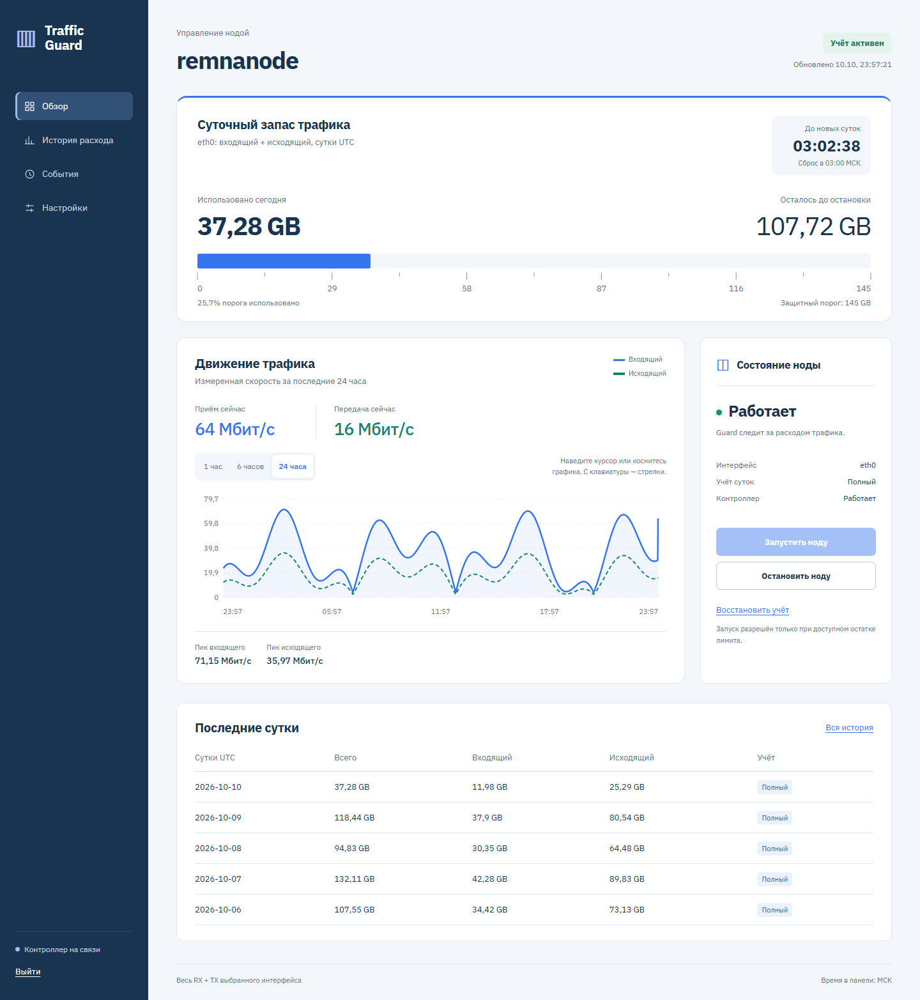
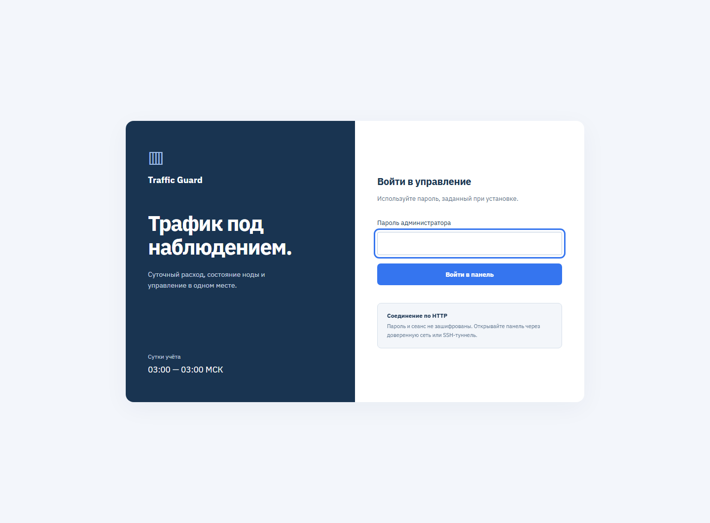
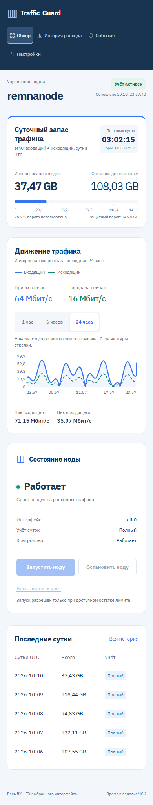
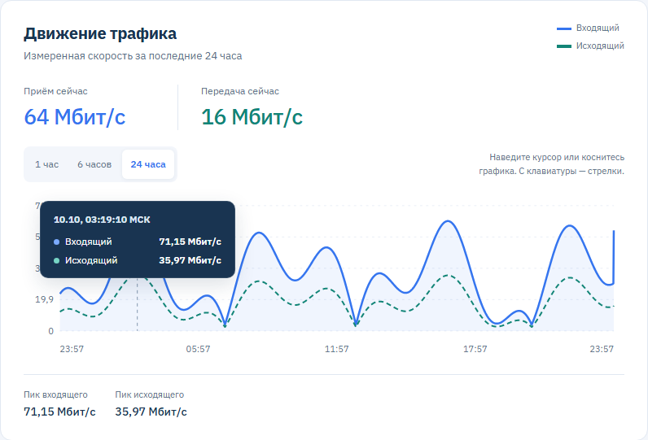
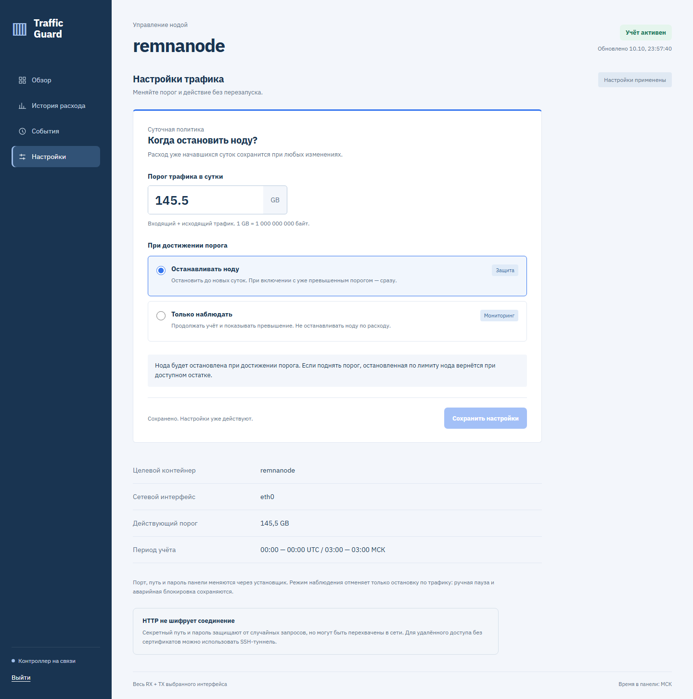
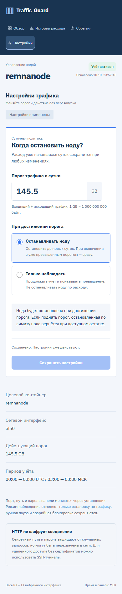

<div align="center">

# Traffic Guard

**Суточный контроль трафика Remnawave с веб-панелью**

Наблюдает за расходом · Останавливает ноду по лимиту · Сохраняет историю


[Установка](#установка) · [Возможности](#возможности) · [Как работает](#как-работает) · [Управление](#управление) · [Безопасность](#безопасность)

</div>



<p align="center"><sub>Панель на демонстрационных данных. Скриншоты сделаны в локальном preview.</sub></p>

Traffic Guard работает в отдельном Docker-контейнере, считает **входящий + исходящий трафик выбранного интерфейса хоста** и управляет контейнером `remnanode`. Веб-панель показывает расход, остаток лимита, скорости, историю и состояние защиты.

> [!IMPORTANT]
> **Первая установка оставляет ноду в текущем состоянии.** До первой надёжно наблюдаемой полуночи UTC — **03:00 МСК** — guard только наблюдает: полный расход уже начавшихся суток неизвестен.

## Возможности

| | Что доступно |
| :--- | :--- |
| **Контроль лимита** | Суточный расход RX + TX, остаток до остановки, отсчёт до новых суток |
| **Мониторинг** | Текущие скорости, график за 1/6/24 часа, пики и значения под курсором или касанием |
| **История** | Расход по дням, отметки неполного учёта, экспорт CSV |
| **Перезагрузка сервера** | Продолжение с сохранённым расходом и учёт трафика после загрузки |
| **Управление нодой** | Ручная остановка, запуск с проверкой лимита, восстановление учёта |
| **Настройки из панели** | Порог в GB и действие при превышении; применение сразу, без перезапуска |
| **Диагностика** | Состояние контейнера, интерфейса и контроллера; журнал событий |
| **Автоустановка** | Проверка зависимостей, установка недостающих пакетов, создание пользователя и каталогов |
| **Отдельная веб-панель** | Пароль, случайный URL, адаптация для телефона; без доступа к Docker socket |

<details>
<summary><strong>Ещё скриншоты: вход и мобильная версия</strong></summary>

### Вход в панель



### Мобильная версия



### Значения на графике



Наведите курсор или коснитесь графика: подсказка покажет время в МСК и обе скорости в Мбит/с. С клавиатуры доступны стрелки, Home/End и Escape. В пропусках истории отображается «Нет измерений». Пики и подсказки относятся к сохранённым измерениям, а не к непрерывной записи каждой сетевой вспышки.

### Настройки с применением сразу





Все значения на скриншотах демонстрационные.

</details>

## Установка

Нужен сервер с **Ubuntu или Debian, systemd и root-доступом**. Поддерживается обычный локальный Docker Engine; rootless Docker, Docker Desktop и удалённый daemon не поддерживаются.

Скачайте проект на сервер и запустите установщик:

```bash
git clone https://github.com/zavul0nn/RUVDS-Traffic-Guard.git
cd RUVDS-Traffic-Guard
sudo bash install.sh
```

Также можно скачать ZIP через **Code → Download ZIP**, распаковать его и выполнить `sudo bash install.sh` из каталога проекта.

Установщик проверит зависимости, установит недостающие, соберёт образ и запустит guard вместе с панелью. Если Docker отсутствует, он будет установлен из официального репозитория. Рабочая существующая установка переиспользуется.

Во время установки нужно указать:

| Параметр | Значение |
| :--- | :--- |
| Порт панели | По умолчанию `47479` |
| Секретный путь | Предлагается случайный путь из 32 символов; свой — 20–96 букв, цифр, `_` или `-` |
| Пароль администратора | 12–256 символов, с повторным вводом |

После проверки панели установщик выведет адрес:

```text
http://IP_СЕРВЕРА:47479/СЕКРЕТНЫЙ_ПУТЬ
```

При повторной установке настройки сохраняются; пароль можно оставить прежним или изменить. При NAT используйте внешний адрес сервера. Выбранный порт должен быть разрешён сетевым firewall — установщик не меняет его правила.

### Настройки по умолчанию

| Параметр | Значение |
| :--- | :--- |
| Контейнер ноды | `remnanode` |
| Интерфейс хоста | `eth0` |
| Суточный порог | `145000000000` байт — **145 GB**, десятичные единицы |
| Граница суток | `00:00 UTC` / `03:00 МСК` |
| Интервал опроса | 3 секунды |
| Адрес привязки панели | `0.0.0.0` — все IPv4-адреса сервера |

Другой интерфейс или порог задаются при установке:

```bash
sudo env INTERFACE=ens3 LIMIT_BYTES=145000000000 bash install.sh
```

> [!NOTE]
> Учитывается **весь трафик интерфейса**, включая другие приложения на сервере. Останавливается только `remnanode`. Саму VPN-ноду установщик не создаёт; если контейнера ещё нет, панель сообщит об этом, а guard обнаружит его после появления.

<details>
<summary><strong>Зависимости, перенос со старого guard и установка без диалога</strong></summary>

Установщик проверяет Docker Engine, Compose v2, Buildx, Python 3, curl, ca-certificates, util-linux и инструменты управления пользователями. Недостающие компоненты устанавливаются через apt.

Старый `chanvpn-london-guard-v3.service` отключается после сборки и проверок. Для другого имени передайте `OLD_SERVICE=имя.service`, для пропуска — `OLD_SERVICE=none`. Остальные контроллеры той же ноды нужно отключить самостоятельно.

Для установки без диалога можно передать настройки через переменные окружения и `WEB_PASSWORD_FILE` — путь к защищённому файлу с паролем в первой строке. Не передавайте пароль в командной строке и не сохраняйте его в shell history.

До первой активации guard сохраняет restart policy ноды. При включении защиты устанавливает `restart=no`. В исходном Compose-файле **ноды** также задайте:

```yaml
restart: "no"
```

Это сохранит политику при пересоздании контейнера. После активации неожиданная смена restart policy приводит к защитной блокировке.

</details>

## Как работает

| Ситуация | Поведение guard |
| :--- | :--- |
| **Первая установка** | Наблюдает до надёжной границы суток, не запускает и не останавливает ноду |
| **Начало полного учёта** | Работающая нода продолжает работать; остановленная вручную автоматически не запускается |
| **Порог достигнут** | Останавливает ноду и продолжает учитывать фоновый трафик |
| **Новые сутки** | Обновляет суточный учёт; снимает остановку по лимиту, если учёт достоверен и есть доступный остаток |
| **Ручная остановка** | Сохраняет паузу при смене суток до ручного запуска |
| **Перезагрузка сервера** | Восстанавливает сохранённый расход и добавляет счётчики нового запуска Linux; возвращает ранее работающую ноду, если лимит позволяет |
| **Сбой после активации** | При потере достоверности учёта блокирует работу до ручного восстановления |

Во время первоначального ожидания перезагрузка, сброс счётчиков или длительный пропуск наблюдений откладывают активацию до следующей надёжной границы суток. Ошибки наблюдения в этот период не останавливают ноду.

После активации обычная перезагрузка сервера не требует ручного восстановления. В пределах одних суток сохранённый расход складывается с RX + TX с момента новой загрузки. Если начались новые сутки, старый суточный расход не переносится: учитывается трафик нового запуска. Ручная пауза сохраняется, превышенный лимит в тех же сутках не сбрасывается.

Если новый запуск Linux начался до полуночи, а guard восстановился после неё, весь трафик нового запуска консервативно относится к текущим суткам. Повторный запуск guard не прибавляет эти байты второй раз. Повреждение сохранённого состояния, сброс счётчиков без перезагрузки, смена интерфейса в рамках того же запуска Linux, неверное время или пропуск границы суток без перезагрузки по-прежнему требуют восстановления учёта.

<details>
<summary><strong>Надёжность счётчика и хранение истории</strong></summary>

Основной счётчик сохраняется в JSON атомарно: запись во временный файл, `fsync`, замена и синхронизация каталога. Блокировка `flock` предотвращает одновременную работу двух контроллеров.

Расход сохраняется при каждом опросе (по умолчанию раз в 3 секунды); суточные записи параллельно обновляются в SQLite. Для продолжения после перезагрузки используется основной сохранённый счётчик, поэтому сбой базы истории не обнуляет лимит. При штатном завершении guard останавливает ноду и делает финальную запись счётчиков.

При аварийном выключении хвост трафика между последней сохранённой записью и выключением может быть неизвестен. После перезагрузки учёт продолжается, а текущий день помечается как неполный; следующая надёжно наблюдаемая граница суток начинает полный период. Это автоматическое продолжение, а не гарантия абсолютно точного биллинга при потере питания.

Прирост между опросами, пересекающий границу суток, целиком относится к новым суткам для консервативной оценки. Если он уже достиг порога, нода не запускается даже на короткое время.

История хранится отдельно в SQLite и не определяет решение об остановке: её сбой не обнуляет основной лимит. Суточная история сохраняется за всё время, подробные измерения — за 30 дней, события — до 10 000 записей. Панель показывает график за 24 часа и последние 100 событий.

После сбоев или восстановления периоды могут быть неполными. Разбивка RX/TX в истории может быть меньше независимого надёжного суточного счётчика; неполные периоды помечаются.

</details>

## Управление

Основные действия доступны в панели: остановить ноду, запустить её при доступном лимите, посмотреть историю, скачать CSV и восстановить учёт после устранения сбоя. При потере связи панель отмечает сохранённые данные и блокирует управляющие действия.

### Изменение порога и действия

Откройте **«Настройки»**, задайте суточный порог в **GB**, выберите действие и нажмите **«Сохранить настройки»**. Изменения применяются работающим guard сразу; переустановка и перезапуск не нужны. Расход текущих суток не сбрасывается, настройки сохраняются вместе с состоянием и остаются после перезагрузки сервера и восстановления учёта.

| Действие | Результат |
| :--- | :--- |
| **Останавливать ноду** | Guard останавливает ноду при достижении порога. Если текущий расход уже выше нового порога, остановка происходит сразу |
| **Только наблюдать** | Расход, графики и история продолжаются; панель показывает превышение, но нода по трафику не останавливается |

Повышение порога или переключение на наблюдение возвращает ноду, которую остановил именно лимит, если нет ручной паузы. Самостоятельно остановленная нода не запускается. Ручная пауза, первоначальное ожидание полных суток и аварийная блокировка сохраняются в обоих режимах.

Можно указывать дробные значения, например `145,5`. Настройки из панели имеют приоритет над начальным `LIMIT_BYTES` установщика. Порт, секретный путь и пароль по-прежнему меняются через установщик.

Для диагностики на сервере:

```bash
# Текущее состояние и расход
sudo docker exec remnanode-traffic-guard python /app/guard.py status

# Логи контроллера
sudo docker logs --tail 100 -f remnanode-traffic-guard

# Логи панели
sudo docker logs --tail 100 remnanode-traffic-panel

# Состояние проверки здоровья
sudo docker inspect --format '{{.State.Health.Status}}' remnanode-traffic-guard
```

`healthy` означает успешную работу цикла контроллера, включая ожидание или остановку по лимиту. Это не проверка работоспособности VPN. Сам статус `unhealthy` не вызывает автоматический перезапуск Docker-контейнера.

### Восстановление после сбоя

После устранения причины нажмите **«Восстановить учёт»** в панели или выполните:

```bash
cd /opt/remnanode-traffic-guard
sudo docker --host unix:///var/run/docker.sock compose stop guard
sudo docker --host unix:///var/run/docker.sock compose run --rm --no-deps guard rearm
sudo docker --host unix:///var/run/docker.sock compose up -d
```

> [!WARNING]
> Восстановление (`rearm`) **останавливает ноду до следующей надёжной границы суток** и сохраняет прежние state/fault в резервные копии. Оно не позволяет обнулить расход и продолжить работу в уже начавшихся сутках. При первой установке действует отдельный пассивный режим.

При штатной остановке уже активированного guard он останавливает ноду и сохраняет намерение вернуть её после проверки учёта. Остановка guard во время первоначального пассивного ожидания оставляет ноду в текущем состоянии.

### Каталоги на сервере

| Путь | Назначение |
| :--- | :--- |
| `/opt/remnanode-traffic-guard` | Программа и конфигурация Compose |
| `/var/lib/remnanode-traffic-guard` | Счётчик, история, состояние и очередь команд |
| `/var/backups/remnanode-traffic-guard` | Резервные копии |

Установщик создаёт каталоги, права и системного пользователя `traffic-guard-web` без входа и домашнего каталога. Данные доступны панели для чтения, очередь — для передачи команд. Файл хеша пароля имеет права `0440`, `.env` — `0600`, каталог резервных копий — `0700`.

## Безопасность

Панель и контроллер работают в отдельных контейнерах. **Docker socket доступен только контроллеру**: веб-панель работает без root, читает данные через read-only mount и передаёт разрешённые команды через локальную очередь. Изменять основной файл счётчика она не может.

Контроллер работает с read-only rootfs, отключённой сетью и сброшенными Linux capabilities. Доступ к Docker API при этом сохраняет широкие полномочия на хосте.

Доступ к панели защищён паролем: PBKDF2-SHA256 с солью и 600 000 итераций, ограничение попыток входа, HttpOnly / SameSite Strict cookies, проверка Origin и CSRF-токены. Открытый пароль не сохраняется; пароль, cookies и URL не пишутся в access logs. Сессия истекает после 30 минут бездействия или 12 часов; перезапуск панели требует повторного входа.

Вне секретного пути сервер возвращает одинаковый `404` без редиректов и ссылок на панель. Шрифт IBM Plex Sans загружается через Google Fonts с локальным fallback; `Referrer-Policy: no-referrer` предотвращает передачу секретного URL сторонним ресурсам.

> [!CAUTION]
> Открытый TCP-порт можно обнаружить сканированием. Случайный путь затрудняет поиск панели, но **HTTP не шифрует пароль, путь и cookie**: при перехвате сетевого трафика они доступны наблюдателю.

### Доступ через SSH без сертификатов

Чтобы панель была доступна только локально на сервере, установите её с привязкой к loopback:

```bash
sudo env WEB_BIND=127.0.0.1 bash install.sh
```

На своём компьютере откройте туннель:

```bash
ssh -L 47479:127.0.0.1:47479 root@IP_СЕРВЕРА
```

Откройте `http://127.0.0.1:47479/СЕКРЕТНЫЙ_ПУТЬ`. Если выбрали другой порт при установке, замените порт назначения в команде.

При публичном размещении учитывайте, что опубликованные порты Docker могут обходить правила UFW. Ограничение доступа задаётся сетевым firewall или правилами Docker.

## Ограничения

Суточный порог — точка принятия решения об остановке. Между опросами и во время `docker stop` расход продолжается, поэтому возможно превышение. Другие процессы на хосте продолжают использовать сеть после остановки ноды.

При SIGKILL/OOM контроллера, зависшем Docker API или недоступном daemon остановку из того же контейнера гарантировать нельзя. При отказе диска guard пытается остановить ноду, но сохранение аварийного флага не гарантируется. Для строгого сетевого потолка нужен независимый механизм на хосте или в сети; ограничение скорости также помогает уменьшить превышение.

Сверьте способ подсчёта RX + TX и границу суток с биллингом провайдера.

## Разработка и проверка

Приложение использует стандартную библиотеку Python. Для локального просмотра панели Docker не нужен:

```bash
# Тесты контроллера и HTTP-панели
python -m unittest -v test_guard test_web

# Панель с синтетическим трафиком и имитацией ноды
python preview.py
```

Preview слушает только `127.0.0.1`; адрес и демонстрационный пароль выводятся в консоль. `browser_check.py` проверяет интерфейс через Playwright — это отдельная зависимость для разработки.

**Проверены 88 модульных и HTTP-тестов**, включая изменение порога и режима без перезапуска, продолжение учёта после перезагрузки, сохранение паузы и лимита, смену суток и обновление базы истории. Также проверены браузерные сценарии входа, управления, истории, CSV, изменения настроек, мобильной версии и восстановления. Тесты Python запускаются и при сборке образа.

Установка с реальными apt, systemd, Docker, mount namespace и правами пользователей требует отдельной проверки на Linux-сервере. Локальные проверки не заменяют такую интеграцию. Подробности — в [VALIDATION.md](VALIDATION.md), решения по интерфейсу — в [DESIGN.md](DESIGN.md).

<details>
<summary><strong>Ссылки и материалы</strong></summary>

- [Установка Docker на Ubuntu](https://docs.docker.com/engine/install/ubuntu/)
- [Установка Docker на Debian](https://docs.docker.com/engine/install/debian/)
- [Политики перезапуска Docker](https://docs.docker.com/engine/containers/start-containers-automatically/)
- [OWASP: аутентификация](https://cheatsheetseries.owasp.org/cheatsheets/Authentication_Cheat_Sheet.html)
- [OWASP: управление сессиями](https://cheatsheetseries.owasp.org/cheatsheets/Session_Management_Cheat_Sheet.html)
- [Frontend Design — skill, использованный при разработке панели](https://github.com/anthropics/skills/tree/main/skills/frontend-design)
- [UI UX Pro Max — рекомендации для формы настроек, обратной связи и мобильной версии](https://github.com/nextlevelbuilder/ui-ux-pro-max-skill)

</details>
